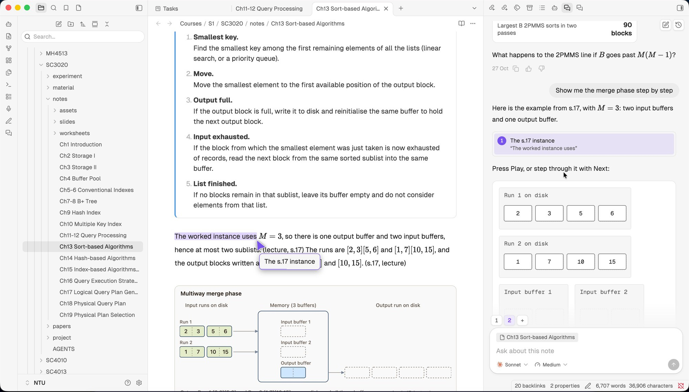

<h1 align="center">Clew</h1>

<p align="center">
  
</p>

> [!WARNING]
> Clew is a work in progress and was developed out of a personal need. Expect missing features, rough edges, and breaking changes between versions. The project is not accepting contributions at this stage.

Clew is a desktop-only Obsidian plugin for studying university-level material. It puts a chat pane beside your note, and the agent can:

- highlight and scroll to parts of the open note,
- read text you quote from the note into the chat,
- answer with native visuals (plots, step-by-step figures, quizzes) drawn in the chat and the note.

Each message sends the open note and your selection. The agent can also read the rest of your vault with its own tools.

## Requirements

- Obsidian 1.13 or later, on desktop
- [Claude Code](https://code.claude.com) 2.1.113 or later, or [Codex](https://github.com/openai/codex), installed and logged in

Clew runs your own installed CLI on your own subscription. It never collects or stores your credentials. To use your own API key instead, add it as an environment variable (for example `ANTHROPIC_API_KEY`) on the plugin's settings page. Clew keeps it in Obsidian's secret storage and passes it only to your CLI.

## Install from source

```bash
npm install
npm run build
```

Then copy `main.js`, `manifest.json` and `styles.css` into `<your vault>/.obsidian/plugins/clew/`, and enable Clew under Settings → Community plugins. If you set `OBSIDIAN_VAULT=/path/to/vault` in `.env.local`, `npm run build` copies the files for you.

## Development

```bash
npm run dev        # rebuild on change
npm run typecheck
npm test
```

## Roadmap

- [x] Chat with Claude Code or Codex beside your notes
- [x] Guided walkthroughs of the open note
- [x] Interactive visuals in the chat
- [x] File and image attachments
- [-] Tool approvals
- [ ] Visuals inside notes
- [ ] Evals and visual coverage
- [ ] Highlights in PDFs
- [ ] Memory and learning dependencies
- [ ] A live tutor that follows along as you study

## Credits

Parts of Clew are adapted from [Claudian](https://github.com/YishenTu/claudian) under the MIT License. See `THIRD_PARTY_NOTICES.md`.
