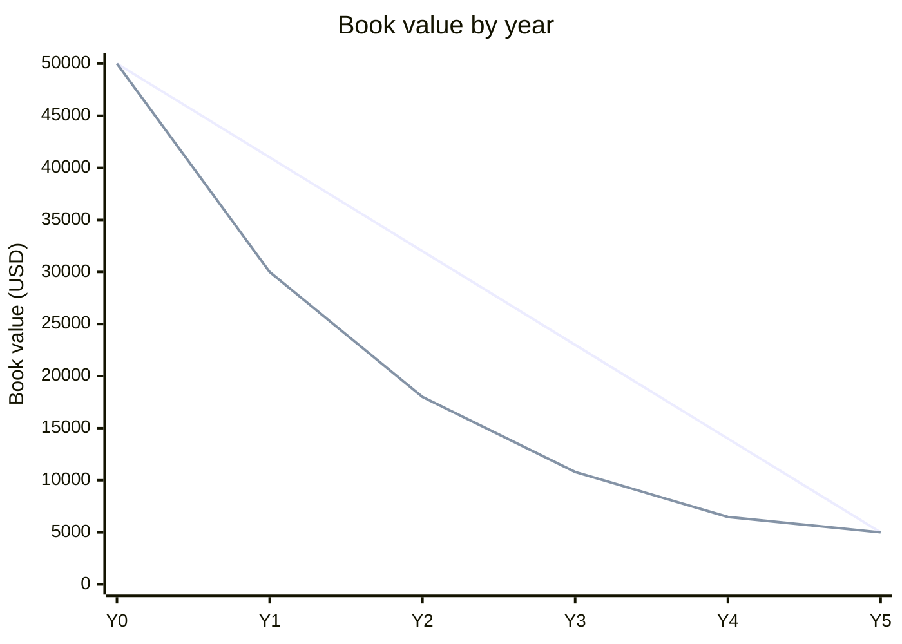

Straight-line depreciates $9,000 every year. DDB depreciates $20,000 in year 1, then less each year. Both methods depreciate the same $45,000 in total. They differ only in timing.

- **Straight-line:** $(50{,}000 - 5{,}000) \div 5 = 9{,}000$ per year.
- **DDB:** rate $= 2 \div 5 = 40\%$, applied to the book value at the start of each year. Salvage does not reduce the rate base, but book value must not fall below $5{,}000$.

| Year | SL depreciation | SL end book value | DDB depreciation | DDB end book value |
|---|---|---|---|---|
| 0 | | 50,000 | | 50,000 |
| 1 | 9,000 | 41,000 | 20,000 | 30,000 |
| 2 | 9,000 | 32,000 | 12,000 | 18,000 |
| 3 | 9,000 | 23,000 | 7,200 | 10,800 |
| 4 | 9,000 | 14,000 | 4,320 | 6,480 |
| 5 | 9,000 | 5,000 | 1,480 | 5,000 |

In year 5, the formula gives $0.4 \times 6{,}480 = 2{,}592$. That would take book value to $3{,}888$, below salvage. So depreciation is capped at $6{,}480 - 5{,}000 = 1{,}480$.

DDB expenses more early and less late. Use it when the asset loses value fast or when the early write-off is wanted. Use straight-line for an even expense each year.

Not checked: tax depreciation rules such as MACRS, which differ from both methods. Risk: a DDB model with no year-5 cap drops book value below the $5,000 salvage.