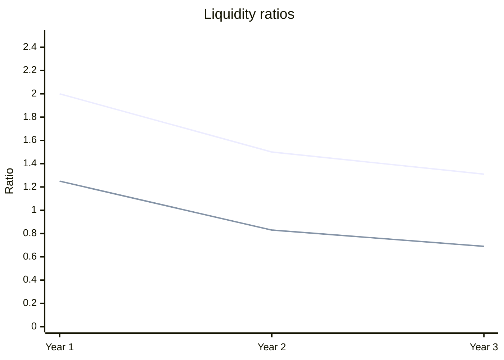

| Ratio | Formula | Year 1 | Year 2 | Year 3 | Trend |
|---|---|---|---|---|---|
| Current ratio | CA / CL | 2.00 | 1.50 | 1.31 | Down |
| Quick ratio | (CA − Inventory) / CL | 1.25 | 0.83 | 0.69 | Down |
| Net profit margin | NI / Revenue | 10.0% | 6.9% | 3.1% | Down |
| ROA | NI / Total assets | 6.7% | 4.5% | 1.9% | Down |
| ROE | NI / Equity | 12.0% | 8.7% | 3.9% | Down |
| Debt ratio | (TA − Equity) / TA | 44.4% | 48.0% | 51.4% | Up |
| Debt-to-equity | (TA − Equity) / Equity | 0.80 | 0.92 | 1.06 | Up |
| Equity multiplier | TA / Equity | 1.80 | 1.92 | 2.06 | Up |
| Asset turnover | Revenue / TA | 0.67 | 0.65 | 0.61 | Down |

Top line is the current ratio, bottom line is the quick ratio.

- Net income fell from 60 to 20 while revenue rose from 600 to 640.
- Liabilities rose from 400 to 540. Equity stayed near 500.
- Quick ratio fell below 1.0 in Year 2. Inventory covers less of current liabilities each year.

I assumed the columns run oldest to newest. Not computed: inventory turnover and days ratios, because they need cost of goods sold. Liabilities are taken as total assets minus equity, which assumes no minority interest.