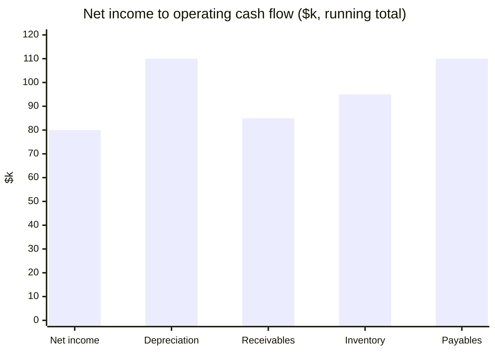

**Operating cash flow is $110k.**

| Step | Change ($k) | Running total ($k) |
|---|---|---|
| Net income | | 80 |
| Depreciation (non-cash add-back) | +30 | 110 |
| Receivables up | -25 | 85 |
| Inventory down | +10 | 95 |
| Payables up | +15 | 110 |

Higher receivables tie up cash, so subtract them. Lower inventory frees cash, so add it.

Skipped: a true floating waterfall. `xychart-beta` cannot float bars, so the chart shows running totals. Not checked: how the chart renders in your terminal.