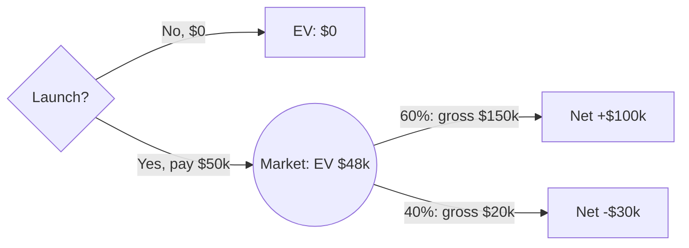

**Launch.** Expected value is **+$48k**, versus $0 for not launching.

I read the $150k and $20k as gross receipts, with the $50k cost paid either way. Net outcomes are +$100k (60%) and -$30k (40%).

$$EV_{\text{launch}} = 0.6(+100) + 0.4(-30) = 60 - 12 = 48\ \text{($k)}$$

$48k > $0, so launch.

Not checked: time value of money, risk aversion, and whether the $150k and $20k already net out the $50k. If they do, EV is $98k and the decision is unchanged.