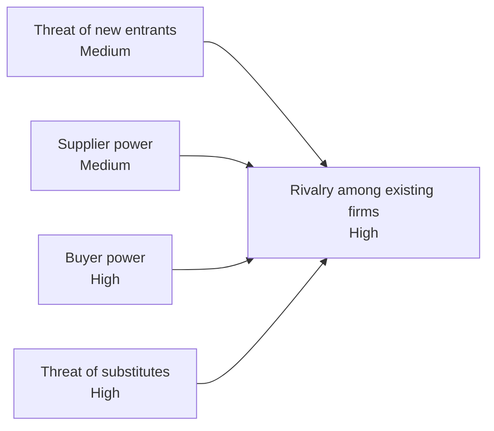

| Force | Strength | Coffee-chain driver |
|---|---|---|
| New entrants | Medium | Independent cafés open cheaply, but prime sites, brand, and scale raise the bar. |
| Supplier power | Medium | Beans are a commodity with volatile prices. Few large roasters and espresso-machine makers. |
| Buyer power | High | Switching cost is near zero. Customers compare prices and nearby options. |
| Substitutes | High | Home brewing, instant coffee, tea, convenience-store coffee, and drive-thrus. |
| Rivalry | High | Chains, independents, fast food, and convenience stores compete for the same sites and hours. |

Not checked: real market data for any named chain. The ratings are judgment, so they may differ by city or country. Test them against local sales and lease data before you use them for a decision.