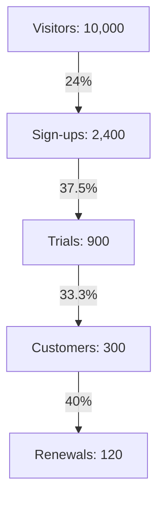

Overall, 3% of visitors become customers, and 1.2% reach a renewal.

| Stage | Count | Step rate | Rate from visitors |
|---|---|---|---|
| Visitors | 10,000 | — | 100% |
| Sign-ups | 2,400 | 24.0% | 24.0% |
| Trials | 900 | 37.5% | 9.0% |
| Customers | 300 | 33.3% | 3.0% |
| Renewals | 120 | 40.0% | 1.2% |

Not checked: whether all counts cover the same time period. The rates assume each stage is a subset of the stage above it.