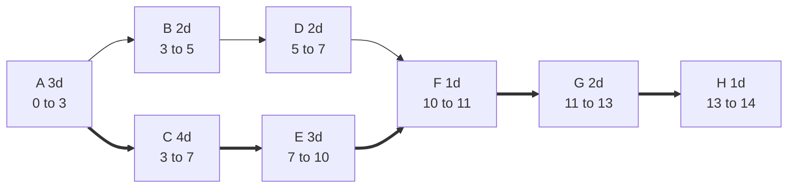

**Critical path: A → C → E → F → G → H. Project length: 14 days.**

Times are in days from start (day 0). ES/EF = earliest start/finish. LS/LF = latest start/finish.

| Task | Dur | Depends on | ES | EF | LS | LF | Float | Critical |
|---|---|---|---|---|---|---|---|---|
| A | 3 | none | 0 | 3 | 0 | 3 | 0 | Yes |
| B | 2 | A | 3 | 5 | 6 | 8 | 3 | No |
| C | 4 | A | 3 | 7 | 3 | 7 | 0 | Yes |
| D | 2 | B | 5 | 7 | 8 | 10 | 3 | No |
| E | 3 | C | 7 | 10 | 7 | 10 | 0 | Yes |
| F | 1 | D, E | 10 | 11 | 10 | 11 | 0 | Yes |
| G | 2 | F | 11 | 13 | 11 | 13 | 0 | Yes |
| H | 1 | G | 13 | 14 | 13 | 14 | 0 | Yes |

Thick arrows are the critical path. B and D have 3 days of float together. They can slip 3 days without moving the finish.

Not checked: working days versus calendar days, and resource limits. A delay on any critical task moves the 14-day finish.