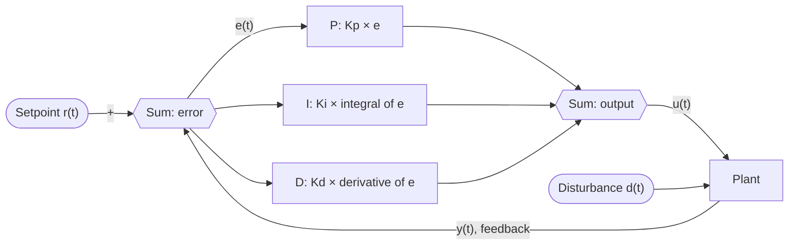

- **Error:** $e(t) = r(t) - y(t)$. The feedback sign is negative.
- **P, I, D:** Each term acts on the same error. Each has its own gain.
- **Output:** The three terms sum to the control signal $u(t)$, which drives the plant.

$$u(t) = K_p\,e(t) + K_i\int_0^t e(\tau)\,d\tau + K_d\,\frac{de(t)}{dt}$$

Not checked: how your viewer draws the `Σ` symbol. Skipped: sensor and actuator blocks, which the request did not ask for.