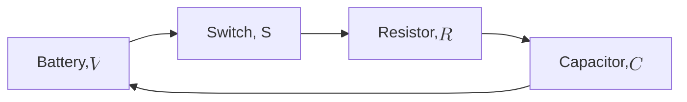

Series loop: battery, switch, resistor, capacitor, back to the battery. The figure tool cannot draw circuits, so this flowchart shows the layout only.

The arrows give the loop order. They do not show current direction.

For a true schematic, use these symbols in the same loop:
- Battery: a long line and a short line, pair repeated.
- Switch: two terminals with an open gap and a hinged arm.
- Resistor: a zigzag.
- Capacitor: two parallel plates.

When the switch closes, current flows and the capacitor charges. The time constant is $\tau = RC$.

Not checked: a rendered schematic. This is layout only.