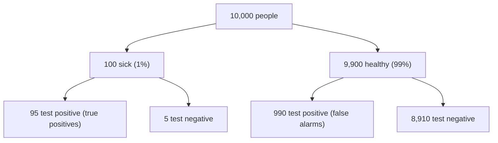

Most positive results are false alarms here. Only about **9 in 100** positives come from people who actually have the disease. The healthy group is 99 times larger than the sick group, so even a 10% false-alarm rate produces many more false positives than true positives.

Take 10,000 people:

The chance that a positive result is correct is called the **positive predictive value**. Bayes' theorem gives it from the prevalence $P(D)$, the sensitivity $P(+ \mid D)$ and the specificity:

$$P(D \mid +) = \frac{P(+ \mid D)\,P(D)}{P(+ \mid D)\,P(D) + P(+ \mid \neg D)\,P(\neg D)}$$

Here $D$ means "has the disease" and $+$ means "tests positive". $P(+ \mid \neg D)$ is the false-alarm rate, which equals 1 minus specificity. Put in the numbers:

$$P(D \mid +) = \frac{0.95 \times 0.01}{0.95 \times 0.01 + 0.10 \times 0.99} = \frac{0.0095}{0.1085} \approx 0.088$$

The false-alarm term, $0.10 \times 0.99 = 0.099$, is about ten times the true-positive term, $0.0095$. The rare disease makes the healthy false positives dominate.

This result depends on the 1% prevalence. In a group where 30% have the disease, the same test gives a positive predictive value of about 80%.