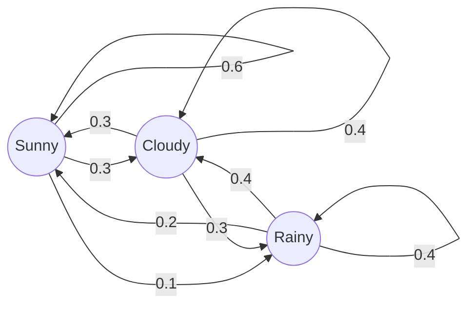

A Markov chain is a sequence of states where tomorrow's state depends only on today's state, not on earlier days. Here the states are Sunny (S), Cloudy (C) and Rainy (R). Row $i$ of the matrix gives the chance of moving from state $i$ to each state the next day.

The distribution $\pi_n$ is a row vector of the probabilities of each state on day $n$. Its entries sum to 1. The chain moves it forward one day at a time:

$$\pi_{n+1} = \pi_n P$$

Here $P$ is the transition matrix, with non-negative entries and each row summing to 1. Each entry of $\pi_{n+1}$ is a weighted sum. For Sunny, it is $\sum_j \pi_n(j)\,P_{j,\text{S}}$: the chance of being in each state yesterday, times the chance of moving from that state to Sunny. This rule holds only while $P$ stays the same every day.

**Worked example.** Start sunny, so $\pi_0 = (1, 0, 0)$. Day 1 is the first row of $P$: $\pi_1 = (0.6, 0.3, 0.1)$.

For day 2, the Sunny entry uses the Sunny column of $P$ (0.6, 0.3, 0.2):

$$\pi_2(\text{S}) = 0.6(0.6) + 0.3(0.3) + 0.1(0.2) = 0.47$$

The Cloudy and Rainy entries use their own columns the same way. Repeating this for each day:

| Day | Sunny | Cloudy | Rainy |
|---|---|---|---|
| 0 | 1.000 | 0.000 | 0.000 |
| 1 | 0.600 | 0.300 | 0.100 |
| 2 | 0.470 | 0.340 | 0.190 |
| 3 | 0.422 | 0.353 | 0.225 |
| 4 | 0.404 | 0.358 | 0.238 |
| 5 | 0.397 | 0.360 | 0.243 |

The probability of sunshine falls from 1 towards about 0.39, and the values settle down over time. This long-run value is the stationary distribution $(24/61, 22/61, 15/61)$. The values are rounded to 3 decimals, so the rows may not sum to exactly 1.000.