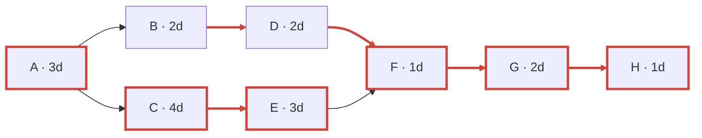

The project takes **14 days**. The critical path is **A → C → E → F → G → H**; the B–D branch has **3 days of slack**.

Schedule below uses day 0 as the start. “Start” and “Finish” are earliest times; Finish marks when each activity is complete.

| Activity | Duration | Start | Finish | Slack |
|---|---:|---:|---:|---:|
| A | 3d | 0 | 3 | 0d |
| B | 2d | 3 | 5 | 3d |
| C | 4d | 3 | 7 | 0d |
| D | 2d | 5 | 7 | 3d |
| E | 3d | 7 | 10 | 0d |
| F | 1d | 10 | 11 | 0d |
| G | 2d | 11 | 13 | 0d |
| H | 1d | 13 | 14 | 0d |

